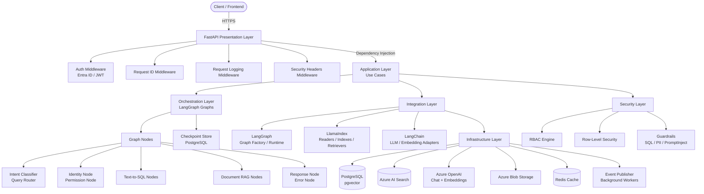

# Enterprise AI Platform

A production-grade, enterprise-ready AI platform built on **FastAPI**, **LangGraph**, and **LlamaIndex**. It enables secure, governed, multi-modal question answering over both structured databases (Text-to-SQL) and unstructured document repositories (Document RAG), with full support for Microsoft Entra ID authentication, role-based access control, and row-level security.

---

## Table of Contents

1. [Project Overview](#1-project-overview)
2. [Architecture Diagram](#2-architecture-diagram)
3. [Framework Responsibility Table](#3-framework-responsibility-table)
4. [Layer Descriptions](#4-layer-descriptions)
5. [Authorization Model](#5-authorization-model)
6. [API Endpoint Reference](#6-api-endpoint-reference)
7. [Application Startup Lifecycle](#7-application-startup-lifecycle)
8. [Getting Started](#8-getting-started)
9. [Configuration](#9-configuration)
10. [Testing](#10-testing)
11. [Directory Structure](#11-directory-structure)

---

## 1. Project Overview

The Enterprise AI Platform provides a unified API for:

| Capability | Description |
|---|---|
| **Text-to-SQL** | Translate natural-language questions into SQL, execute against registered databases, and return governed results |
| **Document RAG** | Ingest, chunk, embed, and semantically retrieve enterprise documents (PDF, DOCX, XLSX) |
| **Hybrid RAG** | Combine structured and unstructured retrieval within a single query |
| **Conversational AI** | Stateful, multi-turn chat with persistent conversation history (LangGraph checkpoints) |
| **Security & Governance** | Entra ID authentication, RBAC, vertical access control, row-level security, PII detection, prompt-injection defence |

---

## 2. Architecture Diagram



---

## 3. Framework Responsibility Table

| Framework | Version | Responsibility |
|---|---|---|
| **FastAPI** | ≥ 0.115 | HTTP API layer: routing, middleware, dependency injection, OpenAPI documentation |
| **LangGraph** | ≥ 0.2 | Stateful, multi-step AI workflow orchestration with persistent checkpointing |
| **LlamaIndex** | ≥ 0.11 (core) | Document ingestion, chunking, vector indexing, and semantic retrieval |
| **LangChain OpenAI** | ≥ 0.2 | Adapters for Azure OpenAI chat models and embedding models |
| **SQLAlchemy** | ≥ 2.0 | Async ORM and connection pooling for PostgreSQL |
| **pgvector** | ≥ 0.3 | PostgreSQL vector similarity search extension |
| **Azure AI Search** | SDK ≥ 12 | Managed vector and hybrid search at scale |
| **Pydantic v2** | ≥ 2.7 | Request/response schema validation and settings management |
| **structlog** | ≥ 24 | Structured, context-rich JSON logging |
| **OpenTelemetry** | ≥ 1.25 | Distributed tracing and metrics for observability |
| **Redis** | ≥ 5.0 | Token caching, query result caching, schema metadata caching |
| **Alembic** | ≥ 1.13 | Database schema migrations |

---

## 4. Layer Descriptions

### Presentation Layer (`api/`)

The FastAPI presentation layer is responsible for:

- **Routing** – Seven routers covering health, auth, chat, documents, databases, conversations, and admin endpoints.
- **Middleware** – Request ID propagation, structured logging, and security header injection applied in ASGI order.
- **Schemas** – Pydantic v2 models for all request/response bodies; strict validation at the API boundary.
- **Dependencies** – FastAPI `Depends()` providers for authentication context, database sessions, and service instances.
- **Exception Handlers** – Global handlers mapping domain exceptions to RFC 7807 Problem Details responses.

### Application Layer (`application/`)

Implements the **hexagonal architecture** (ports and adapters) pattern:

- **Use Cases** – Single-responsibility orchestrators that express business workflows in framework-agnostic code.
- **Services** – Reusable business logic building blocks consumed by use cases (e.g., SQL generation, schema retrieval).
- **Interfaces (Ports)** – Abstract base classes defining contracts for every external dependency (LLM, embeddings, vector store, SQL executor, checkpoint store, etc.).

No framework-specific code lives in this layer. All external dependencies are injected via their interface contracts.

### Orchestration Layer (`orchestration/`)

Implements multi-step AI workflows using **LangGraph**:

- **State** – Typed `TypedDict` state definitions for each workflow (chat, text-to-SQL, document RAG).
- **Graphs** – Compiled `StateGraph` instances for each workflow variant.
- **Nodes** – Individual computation units grouped by domain: routing, authorization, text-to-SQL, document RAG, and shared response/error handling.
- **Edges** – Conditional and static edge functions that control workflow routing.
- **Checkpoint** – PostgreSQL-backed checkpointer enabling durable, resumable conversation state.
- **Registry** – A runtime registry that holds compiled graph instances and resolves them by workflow type.

### Integration Layer (`integrations/`)

Bridges the application layer to specific frameworks:

- **LangGraph** – Graph factory, runtime invocation, and callback hooks for telemetry.
- **LlamaIndex** – Document readers (PDF, DOCX, XLSX), transformation pipeline, vector index management, and retriever adapters.
- **LangChain** – Thin adapters wrapping `AzureChatOpenAI` and `AzureOpenAIEmbeddings` to satisfy application interface contracts.

### Infrastructure Layer (`infrastructure/`)

Concrete adapter implementations for all external technologies:

| Sub-package | Technology | Purpose |
|---|---|---|
| `database/` | PostgreSQL + SQLAlchemy | ORM models, repositories, session factory |
| `retrieval/pgvector/` | pgvector | Vector similarity search repository |
| `retrieval/azure_ai_search/` | Azure AI Search | Managed search index client |
| `llm/azure_openai/` | Azure OpenAI | Chat completion and embedding API calls |
| `document_processing/` | Docling / OCR | File parsing and text extraction |
| `storage/` | Azure Blob / Local FS | Binary document persistence |
| `cache/` | Redis | Key-value caching |
| `messaging/` | Event Publisher | Background job dispatch |

### Security Layer (`security/`)

Cross-cutting security concerns applied at multiple layers:

- **Authentication** – Microsoft Entra ID token validation; JWT signature verification and claims extraction.
- **Authorization** – RBAC engine for role-based resource access; policy engine for attribute-based decisions.
- **Row-Level Security** – RLS context propagation and predicate injection into SQL queries.
- **Guardrails** – SQL injection detection, PII identification and redaction, prompt injection defence.

---

## 5. Authorization Model

The platform implements a four-tier authorization model:

| Tier | Actors | Scope | Description |
|---|---|---|---|
| **Self** | End users | Own data only | Users can read and modify their own conversations, uploaded documents, and preferences |
| **Vertical** | Business unit members | Column/attribute level | Access to specific columns or attributes within a dataset, enforced by the vertical access service |
| **Chief** | Data stewards, managers | Row-level filtered | Full table access with row-level security filters applied based on group membership |
| **Admin** | Platform administrators | Unrestricted | Full platform access including user management, system configuration, and audit logs |

Authorization decisions are enforced at every layer:
1. **API** – JWT claims validated in middleware; role membership checked in route dependencies.
2. **Application** – Use cases invoke the `AuthorizeDataAccess` use case before executing queries.
3. **Orchestration** – The `PermissionNode` in every graph enforces RBAC and injects RLS context.
4. **Infrastructure** – RLS predicates are appended to all SQL queries via the `RlsContext`.

---

## 6. API Endpoint Reference

All endpoints are prefixed with `/api/v1`.

### Health

| Method | Path | Description |
|---|---|---|
| `GET` | `/api/v1/health/live` | Kubernetes liveness probe |
| `GET` | `/api/v1/health/ready` | Kubernetes readiness probe (checks DB, Redis, Azure) |

### Authentication

| Method | Path | Description |
|---|---|---|
| `POST` | `/api/v1/auth/token` | Exchange Entra ID token for platform session token |
| `POST` | `/api/v1/auth/refresh` | Refresh an expiring session token |
| `DELETE` | `/api/v1/auth/logout` | Invalidate the current session token |

### Chat

| Method | Path | Description |
|---|---|---|
| `POST` | `/api/v1/chat` | Execute a single-turn chat request; returns a complete response |
| `POST` | `/api/v1/chat/stream` | Execute a streaming chat request; returns an SSE stream of token deltas |

### Conversations

| Method | Path | Description |
|---|---|---|
| `GET` | `/api/v1/conversations` | List all conversations for the authenticated user |
| `GET` | `/api/v1/conversations/{id}` | Retrieve a conversation and its full message history |
| `DELETE` | `/api/v1/conversations/{id}` | Delete a conversation and all associated state |

### Documents

| Method | Path | Description |
|---|---|---|
| `POST` | `/api/v1/documents` | Upload and ingest a new document (PDF, DOCX, XLSX) |
| `GET` | `/api/v1/documents` | List all documents accessible to the authenticated user |
| `GET` | `/api/v1/documents/{id}` | Retrieve document metadata and status |
| `DELETE` | `/api/v1/documents/{id}` | Delete a document and remove it from all indexes |
| `POST` | `/api/v1/documents/search` | Semantic search across the document knowledge base |

### Databases (Text-to-SQL)

| Method | Path | Description |
|---|---|---|
| `POST` | `/api/v1/databases` | Register a new structured data source |
| `GET` | `/api/v1/databases` | List all registered databases accessible to the user |
| `GET` | `/api/v1/databases/{id}` | Retrieve database metadata and schema summary |
| `DELETE` | `/api/v1/databases/{id}` | Deregister a data source |
| `POST` | `/api/v1/databases/{id}/query` | Execute a natural-language query against a registered database |

### Admin

| Method | Path | Description |
|---|---|---|
| `GET` | `/api/v1/admin/users` | List platform users |
| `POST` | `/api/v1/admin/users` | Create a new platform user |
| `PATCH` | `/api/v1/admin/users/{id}` | Update user role assignments |
| `DELETE` | `/api/v1/admin/users/{id}` | Deactivate a user account |
| `GET` | `/api/v1/admin/stats` | Platform usage statistics |

---

## 7. Application Startup Lifecycle

The platform follows a deterministic startup sequence managed by the FastAPI lifespan context manager (`lifespan.py`):

```
1. Load Settings (pydantic-settings / .env)
        │
2. Configure Structured Logging (structlog)
        │
3. Initialise OpenTelemetry Tracing & Metrics
        │
4. Create SQLAlchemy Async Engine & Connection Pool
        │
5. Run Alembic Migrations (if configured)
        │
6. Connect to Redis Cache
        │
7. Initialise Azure OpenAI Client (Chat + Embeddings)
        │
8. Configure LlamaIndex Settings (LLM, embed model, service context)
        │
9. Load / Build LlamaIndex Indexes (pgvector / Azure AI Search)
        │
10. Initialise LangGraph PostgreSQL Checkpointer
        │
11. Compile LangGraph Workflow Graphs
            ├── ChatGraph
            ├── TextToSQLGraph
            ├── DocumentRAGGraph
            └── HybridRAGGraph
        │
12. Register Graphs in GraphRegistry
        │
13. ✅ Begin accepting HTTP requests
```

**Shutdown** (reverse order):

```
1. Stop accepting new requests
2. Wait for in-flight requests to complete (graceful drain)
3. Close LangGraph checkpointer connection
4. Close Redis connection pool
5. Dispose SQLAlchemy engine
6. Flush OpenTelemetry spans
```

---

## 8. Getting Started

### Prerequisites

- Python 3.11+
- Docker & Docker Compose
- Access to an Azure subscription with:
  - Azure OpenAI (GPT-4o + text-embedding-3-large deployments)
  - Azure AI Search
  - Azure Blob Storage
  - Microsoft Entra ID application registration

### Installation

#### With `uv` (recommended)

```bash
# Install uv
curl -LsSf https://astral.sh/uv/install.sh | sh

# Create and activate virtual environment
uv venv .venv
source .venv/bin/activate   # Windows: .venv\Scripts\activate

# Install all dependencies
uv pip install -e ".[dev]"
```

#### With `pip`

```bash
python -m venv .venv
source .venv/bin/activate   # Windows: .venv\Scripts\activate
pip install -e ".[dev]"
```

### Configure Environment

```bash
cp .env.example .env
# Edit .env with your Azure credentials and connection strings
```

### Run Locally

```bash
# Start infrastructure (PostgreSQL + Redis)
docker compose up postgres redis -d

# Run database migrations
alembic upgrade head

# Start the API server
uvicorn enterprise_ai_platform.main:app --reload --host 0.0.0.0 --port 8000
```

The API will be available at `http://localhost:8000`.  
Interactive docs: `http://localhost:8000/docs`

### Run with Docker

```bash
# Build and start all services
docker compose up --build

# Run migrations inside the container
docker compose exec api alembic upgrade head
```

---

## 9. Configuration

### Environment Variables

All settings are defined in `src/enterprise_ai_platform/core/config.py` and loaded from environment variables or `.env`.

| Variable | Default | Description |
|---|---|---|
| `APP_NAME` | `Enterprise AI Platform` | Application display name |
| `APP_VERSION` | `0.1.0` | Application version |
| `DEBUG` | `false` | Enable debug mode |
| `DATABASE_URL` | — | PostgreSQL connection string |
| `AZURE_OPENAI_ENDPOINT` | — | Azure OpenAI resource endpoint |
| `AZURE_OPENAI_API_KEY` | — | Azure OpenAI API key |
| `AZURE_OPENAI_DEPLOYMENT` | — | Chat model deployment name |
| `AZURE_OPENAI_EMBEDDING_DEPLOYMENT` | — | Embedding model deployment name |
| `AZURE_SEARCH_ENDPOINT` | — | Azure AI Search endpoint |
| `AZURE_SEARCH_API_KEY` | — | Azure AI Search admin key |
| `AZURE_SEARCH_INDEX_NAME` | — | Default search index name |
| `AZURE_BLOB_CONNECTION_STRING` | — | Azure Blob Storage connection string |
| `AZURE_BLOB_CONTAINER` | `documents` | Blob container name |
| `REDIS_URL` | `redis://localhost:6379/0` | Redis connection URL |
| `ENTRA_TENANT_ID` | — | Microsoft Entra ID tenant ID |
| `ENTRA_CLIENT_ID` | — | Entra application (client) ID |
| `ENTRA_CLIENT_SECRET` | — | Entra client secret |

### YAML Configuration Files

Environment-specific YAML files in `config/` override defaults at runtime:

| File | Environment | Key Settings |
|---|---|---|
| `development.yaml` | Local development | `debug: true`, small pool sizes, low concurrency |
| `staging.yaml` | Staging / QA | `debug: false`, medium pool sizes |
| `production.yaml` | Production | `debug: false`, large pool sizes, max concurrency |

---

## 10. Testing

### Run All Tests

```bash
pytest
```

### Run Specific Suites

```bash
# Unit tests only
pytest tests/unit -v

# Integration tests (requires running PostgreSQL and Redis)
pytest tests/integration -v

# Architecture tests (dependency rule enforcement)
pytest tests/architecture -v

# Security tests
pytest tests/security -v

# Orchestration / LangGraph tests
pytest tests/orchestration -v

# End-to-end tests (requires full stack)
pytest tests/e2e -v
```

### Coverage Report

```bash
pytest --cov=src/enterprise_ai_platform --cov-report=html
open htmlcov/index.html
```

### Linting and Type Checking

```bash
# Lint and format
ruff check src/ tests/
ruff format src/ tests/

# Static type checking
mypy src/
```

---

## 11. Directory Structure

```
Text-to-SQL/                               # Project root
├── src/
│   ├── main.py                            # FastAPI application entry point
│   ├── lifespan.py                        # Startup / shutdown lifecycle manager
│   │
│   ├── api/                               # Presentation layer (HTTP / REST)
│   │   ├── dependencies.py                # FastAPI dependency injection providers
│   │   ├── exception_handlers.py          # RFC 7807 global error handlers
│   │   ├── middleware/                    # ASGI middleware pipeline
│   │   │   ├── authentication.py          #   Entra ID JWT authentication & user context
│   │   │   ├── logging.py                 #   Structured request logging
│   │   │   ├── request_id.py              #   Correlation / request ID injection
│   │   │   └── security_headers.py        #   Security response headers (OWASP)
│   │   ├── routes/                        # API routers & endpoint controllers
│   │   │   ├── auth.py                    #   Token exchange & session endpoints
│   │   │   ├── conversations.py           #   Conversation & multi-turn message endpoints
│   │   │   ├── feedback.py                #   Message feedback & rating endpoints
│   │   │   └── health.py                  #   Liveness & readiness probes
│   │   └── schemas/                       # Pydantic v2 request/response schemas
│   │       ├── auth.py                    #   Authentication schemas
│   │       ├── conversation.py            #   Conversation metadata schemas
│   │       ├── feedback.py                #   Feedback rating & comment schemas
│   │       └── message.py                 #   Chat & message schemas
│   │
│   ├── core/                              # Cross-cutting platform foundation
│   │   ├── config.py                      #   pydantic-settings environment configuration
│   │   ├── constants.py                   #   Application constants & defaults
│   │   ├── database.py                    #   SQLAlchemy Base, AsyncEngine & Session factory
│   │   ├── events.py                      #   In-memory async event bus
│   │   ├── exceptions.py                  #   Domain & application exception hierarchy
│   │   ├── logging.py                     #   structlog configuration & processors
│   │   └── telemetry.py                   #   OpenTelemetry traces & metrics setup
│   │
│   ├── auth/                              # Security, RBAC & Data Governance
│   │   ├── access_context.py              #   Resolved access context & table permissions
│   │   ├── handlers/                      #   Vertical policy handlers (attendance, project, etc.)
│   │   ├── join_validation.py             #   JoinGraphValidator & approved enterprise joins
│   │   ├── models.py                      #   User SQLAlchemy ORM model
│   │   ├── policy_resolver.py             #   RBAC policy resolution engine
│   │   ├── predicate_spec.py              #   Row-level predicate generation specifications
│   │   ├── repository.py                  #   UserContextRepository
│   │   ├── role.py                        #   Role & Area enums
│   │   ├── user.py                        #   UserContext & RequestIdentity value objects
│   │   └── user_context_service.py        #   User identity & vertical assignment service
│   │
│   ├── text_to_sql/                       # Core Text-to-SQL Engine & pgvector Catalog
│   │   ├── ast_validator.py               #   SQL AST validator & security enforcer
│   │   ├── authorized_schema.py           #   Schema projection & filtering by user context
│   │   ├── catalog.py                     #   MetadataCatalog for table/column business descriptions
│   │   ├── document_builder.py            #   Schema & entity document builder
│   │   ├── embedding_worker.py            #   Async schema embedding sync worker
│   │   ├── entity_document.py             #   Entity document definitions & builders
│   │   ├── entity_vector_store.py         #   pgvector store & LlamaIndex retriever for entities
│   │   ├── entity_worker.py               #   Async entity embedding sync worker
│   │   ├── intent_classifier.py           #   Query intent classifier
│   │   ├── introspector.py                #   PostgreSQL schema introspector
│   │   ├── metadata.py                    #   Table & column metadata entities
│   │   ├── models.py                      #   SchemaEmbeddingModel & EntityEmbeddingModel ORM
│   │   ├── policy_enforcer.py             #   SQL policy enforcer
│   │   ├── predicate_injector.py          #   Row-level predicate injection
│   │   ├── retrieval.py                   #   Hybrid schema retrieval service
│   │   ├── retriever_interface.py         #   ISchemaRetriever abstract port
│   │   ├── router_retriever.py            #   Router-based schema retriever
│   │   ├── schema.py                      #   DatabaseSchemaEntity & catalog models
│   │   ├── schema_document.py             #   Schema document definitions & hashing
│   │   ├── schema_events.py               #   SchemaChangeEvent & SchemaChangeType
│   │   ├── schema_vector_store.py         #   pgvector store & LlamaIndex retriever for schemas
│   │   ├── scope_resolver.py              #   SQL scope resolver
│   │   └── vector_store_interfaces.py     #   IVectorStore abstract port & search results
│   │
│   ├── chat/                              # Conversational Management & Streaming
│   │   ├── context_service.py             #   Context window & token budget management
│   │   ├── conversation.py                #   Conversation entities & enums
│   │   ├── exceptions.py                  #   Chat domain exceptions
│   │   ├── feedback_service.py            #   User feedback collection service
│   │   ├── message.py                     #   Message entities & role definitions
│   │   ├── message_service.py             #   Message persistence & retrieval service
│   │   ├── mock_ai_generator.py           #   Development / mock stream generator
│   │   ├── models.py                      #   Conversation, Message & Feedback ORM models
│   │   ├── protocols.py                   #   AIGeneratorProtocol & streaming contracts
│   │   ├── repositories/                  #   Database repository implementations
│   │   │   ├── conversation_repo.py       #     Conversation CRUD operations
│   │   │   ├── feedback_repo.py           #     Feedback CRUD operations
│   │   │   ├── message_repo.py            #     Message history operations
│   │   │   └── summary_repo.py            #     Conversation summary operations
│   │   ├── service.py                     #   Conversation lifecycle service
│   │   ├── sse_formatter.py               #   Server-Sent Events formatter
│   │   └── streaming_orchestrator.py      #   SSE token streaming coordinator
│   │
│   └── providers/                         # External AI Model Integrations
│       ├── azure_openai_client.py         #   Azure OpenAI client initialization & lifecycle
│       ├── chat_model.py                  #   AzureOpenAIChatModel adapter
│       ├── embeddings.py                  #   AzureOpenAIEmbeddings adapter
│       └── interfaces.py                  #   LLMProviderProtocol & EmbeddingProviderProtocol
│
├── migrations/                            # Database migrations & schemas
│   ├── env.py                             # Alembic migration environment
│   ├── script.py.mako                     # Alembic template
│   ├── versions/                          # Alembic version revisions
│   │   └── 20261109_0001_initial_chat_tables.py
│   └── sql/                               # SQL DDL & seed scripts
│       ├── all_schema.sql                 # Consolidated database schema
│       ├── schema/                        # Table DDL schemas
│       └── insert/                        # Seed data SQL scripts
│
├── tests/                                 # Test suite
│   ├── conftest.py                        # Pytest fixtures and test setup
│   ├── integration/                       # Integration tests
│   │   ├── test_azure_openai_live.py
│   │   ├── test_conversation_api.py
│   │   ├── test_repositories.py
│   │   ├── test_streaming.py
│   │   └── test_user_context_api.py
│   └── unit/                              # Unit tests
│       ├── auth/                          # RBAC and authorization unit tests
│       ├── text_to_sql/                   # Text-to-SQL & catalog unit tests
│       ├── test_auth_middleware.py
│       ├── test_azure_openai.py
│       ├── test_conversation_domain.py
│       ├── test_logging.py
│       ├── test_rbac_authorization.py
│       ├── test_request_id_middleware.py
│       ├── test_request_logging_middleware.py
│       ├── test_security_headers.py
│       ├── test_telemetry.py
│       └── test_user_context_service.py
│
├── config/                                # Environment configuration files
│   ├── development.yaml                   # Development environment overrides
│   ├── staging.yaml                       # Staging environment overrides
│   └── production.yaml                    # Production environment overrides
│
├── docker/                                # Container definitions
│   ├── Dockerfile.api                     # FastAPI web server image
│   ├── Dockerfile.chainlit                # Chainlit UI container image
│   └── Dockerfile.worker                  # Background worker container image
│
├── docs/                                  # Extended documentation & schemas
│   ├── Schema.md                          # Database schema reference
│   └── ChatGPT-*.md                       # Reference prompt transcripts & specifications
│
├── scripts/                               # Automation & deployment scripts
├── docker-compose.yml                     # Local multi-service composition
├── pyproject.toml                         # Project metadata, dependencies & tooling
├── requirements.txt                       # Pinned dependency list
├── alembic.ini                            # Alembic migration configuration
├── .env.example                           # Environment variable template
└── .gitignore                             # Git ignore rules
```

---

## License

Proprietary — All rights reserved.
